# User Guide

_Orrery — read-this-first guide for the live app · 0.9.9 · November 2026_

> Every screenshot in this guide is the app at 1280×800 in English (the language shots are the exceptions). Click any image to open it full-size in a new tab.

## Finding your way around

The navigation bar reads, left to right: **HOME · EXPLORE · WORLDS · FLY · PLAN · CATALOG · LEARN**. EXPLORE, WORLDS, CATALOG and LEARN open a menu; each also has a hub page of its own (`/explore/hub`, `/worlds`, `/catalog`, `/learn`) with a card per destination.

| Group | What is in it |
|---|---|
| **EXPLORE** | `/explore` — one level per scale, from the solar system out to the cosmic web |
| **WORLDS** | `/earth`, `/moon`, `/mars`, `/venus` — the worlds you can stand on |
| **FLY**, **PLAN** | `/fly` the mission arc, `/plan` the porkchop mission configurator |
| **CATALOG** | `/programs`, `/missions` (+ `/missions/launches`), `/fleet`, `/iss`, `/tiangong`, `/live` |
| **LEARN** | `/essays`, `/science`, `/lab` |
| **Footer** | Gallery (deep-sky, posters, insignia), Credits, Colophon, Library, Glossary, About |

---

---

## On your phone

Orrery is **mobile-first** — every route adapts to a phone: a hamburger nav, bottom-sheet panels, and touch gestures on the 3D scenes (one-finger drag to orbit, **pinch to zoom**, tap to select).

- **Native apps (iOS + Android)** are in progress (v0.8) — a Capacitor wrapper of this same web app, headed for the App Store + Google Play. Same experience, installed from a store, with a native share sheet and offline core.
- **Right now** you can install the web app as a PWA: open the site in your phone browser and use "Add to Home Screen" (Android Chrome offers an install prompt; iOS Safari → Share → Add to Home Screen).

The rest of this guide describes the app screen-by-screen — it reads the same on desktop and phone.

---

## Switching language

A locale picker sits in the top-right of the navigation bar. The chip shows the locale's short tag (e.g. `DE`). Click it to open the dropdown, pick your language, and the URL updates to the locale-prefixed path (e.g. `/de/…`). Bookmark the URL to lock your locale; share it and your reader gets the same. (Flag emoji were dropped — they render inconsistently across platforms; the short tag is unambiguous everywhere.)

The URL is the main place your locale lives; the only thing stored is a small functional cookie (`orrery_locale`), written *only* when you click a locale chip (see [Privacy](#privacy)). On a fresh visit the browser language is sniffed (`navigator.language`) and applied automatically; if it doesn't match a supported locale, English is the default.

[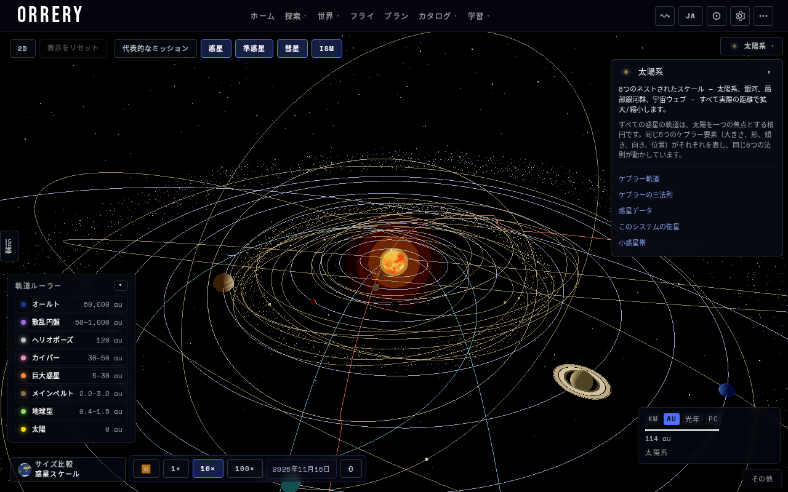](screenshots/locale-ja.png)

**Currently shipped — 14 languages, all at 100% UI parity:**

| Locale | Native name | Notes |
|---|---|---|
| `en-US` | English | Source language |
| `es` | Español | First non-English locale (v0.3.0) |
| `fr` | Français | |
| `de` | Deutsch | |
| `pt-BR` | Português (BR) | |
| `it` | Italiano | |
| `nl` | Nederlands | Added v0.5.x (issue #72) |
| `zh-CN` | 中文 (简体) | |
| `ja` | 日本語 | |
| `ko` | 한국어 | |
| `hi` | हिन्दी | Devanagari |
| `ar` | العربية | RTL — flips the entire layout |
| `ru` | Русский | Cyrillic |
| `sr-Cyrl` | Српски | Serbian Cyrillic |

The `/science` encyclopedia overlay tree is translated end-to-end across **all 14 locales**. Editorial entity overlays (missions, planets, sites, modules) are translated across all 14 locales for the v0.5.x rollout.

---

## Solar System Explorer · `/explore`

A real-time 3D / 2D orrery in **eight nested scales**: Solar System · Stellar Neighborhood · Milky Way · Local Group · Local Sheet · Virgo Supercluster · Laniakea · Cosmic Web. The solar-system scale shows 8 planets, 5 dwarf planets, 2 comets, and ʻOumuamua (the only confirmed interstellar object).

[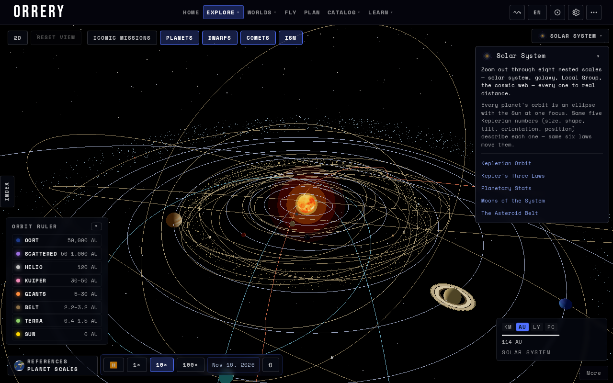](screenshots/01-explore.png)

**Moving between scales**:

- **Zoom in or out** — the scene passes through the eight scales as you scroll or pinch — or use the **level picker** (top right) and the **back** button.
- **One scale bar** (bottom right) reads in KM · AU · LY · PC; click a unit to switch.
- **INDEX** (the tab on the left edge) opens the same panel at every scale: every selectable object of the scene, a search box, kind chips, and a ↗ on every object that has a page of its own. Picking a row selects and focuses the object.
- **ORBIT RULER** (bottom left) lists the orbit regimes of the scale (Oort cloud in to the Sun on the solar-system scale); each row draws its own band.

**What you can do**:

- **Drag** the 3D scene to orbit around the Sun.
- **Scroll** / **pinch** to zoom.
- **Click any body** — Sun, planet, dwarf, comet, ʻOumuamua — to open its detail panel with **OVERVIEW · GALLERY · TECHNICAL · MISSIONS** tabs.
- **Hover** in 3D for a velocity tooltip (mean orbital velocity via vis-viva).
- **`2D` toggle** (top right) — switches to a top-down 2D plot of the ecliptic plane.
- **`REFERENCES · PLANET SCALES`** (bottom left) — opens a true-relative-size diorama of the planets.
- **Chip row** (top left) — ICONIC MISSIONS · PLANETS · DWARFS · COMETS · ISM show / hide each group independently. Hidden bodies aren't clickable, and turning a chip off clears a selection inside it.
- **Time dock** (bottom) — pause, 1× / 10× / 100× speed, and the date.
- **Stars and deep-sky objects** open a panel with **OVERVIEW** and **IN THE SKY** tabs. IN THE SKY draws the object's constellation as a line figure with the object marked, and prints its constellation, position, the nearest bright star (within 15°), the best months to see it, how high it climbs from your latitude (taken from your browser's time zone — no permission prompt), and what shows it: naked eye, binoculars, or a telescope. Every number is computed from the object's own RA / Dec and magnitude; the Sun's position for the best-months rule comes from NASA JPL Horizons.

[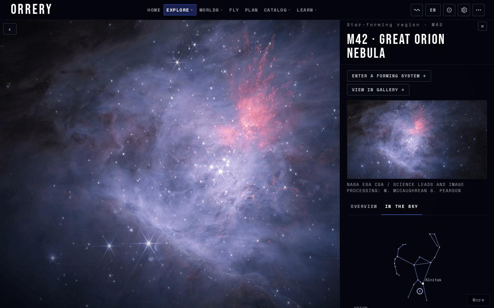](screenshots/20-explore-in-the-sky.png)

**Turn on the Science Lens** (the lens icon in the nav) and the scene becomes a textbook layer (the [ISS section](#iss-explorer-iss) shows it on a station scene).

A **Science Lens banner** above the canvas explains the current view in plain language; a **Science Layers panel** lets you toggle individual physics layers (gravity vectors, velocity vectors, centripetal arrows, apsides + true anomaly, sphere-of-influence rings, hover info cards). Layer values print at arrow tips so you can compare magnitudes across planets.

---

## Mission Configurator · `/plan`

The Lambert porkchop plot. Pick a destination + mission type (LANDING or FLYBY). The destination menu has 22 destinations in five groups — Inner system (Moon, Mercury, Venus, Mars, Phobos, Deimos), Asteroids (Vesta, Ceres, Psyche, Bennu), Jupiter system (Jupiter, Io, Europa, Ganymede, Callisto), Saturn system (Saturn, Titan, Enceladus) and Outer system (Uranus, Neptune, Triton, Pluto); a planetary moon flies its host planet's arc with the moon named as the target. Each destination uses a **pre-computed** 112×100 grid (11,200 cells) checked in at `static/data/porkchop/` and loaded by the app at runtime — the Lambert **Web Worker** stays in the bundle for future custom-range work but is **not** what paints the default Mercury–Pluto maps. Deep-blue cells are the cheap launch windows; red cells are expensive.

[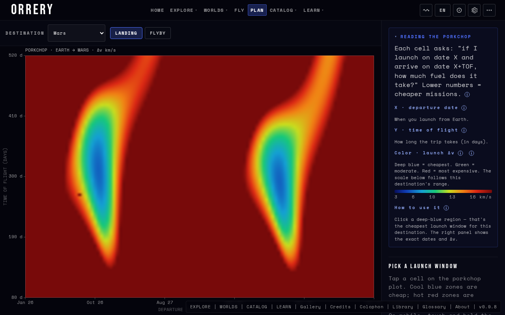](screenshots/02-plan.png)

**What you can do**:

- **Click any cell** to read the exact dep / arr dates, transit, and ∆v.
- **Pick a vehicle** from 13 launch rockets — the panel computes vehicle ∆v vs required ∆v and shows margin or deficit.
- **▶ FLY MISSION** — opens `/fly` with your selected destination, dep / arr dates and rocket baked into the URL (`/fly?dest&type&dep&tof&rocket`); it is enabled only while the rocket's ∆v budget holds. The rocket you picked is the vehicle the flight shows and the one that launches.
- **Mobile**: long-press the porkchop for a magnifier loupe.

**Mission Sandbox** (lens on or off — always available): pin one cell with `📌 PIN THIS CELL`, then click another cell. The compare panel shows ΔDEP, ΔTOF, and Δ∆v (green chip when the new cell is cheaper, gold when more expensive). Pin clears automatically when you change destination.

[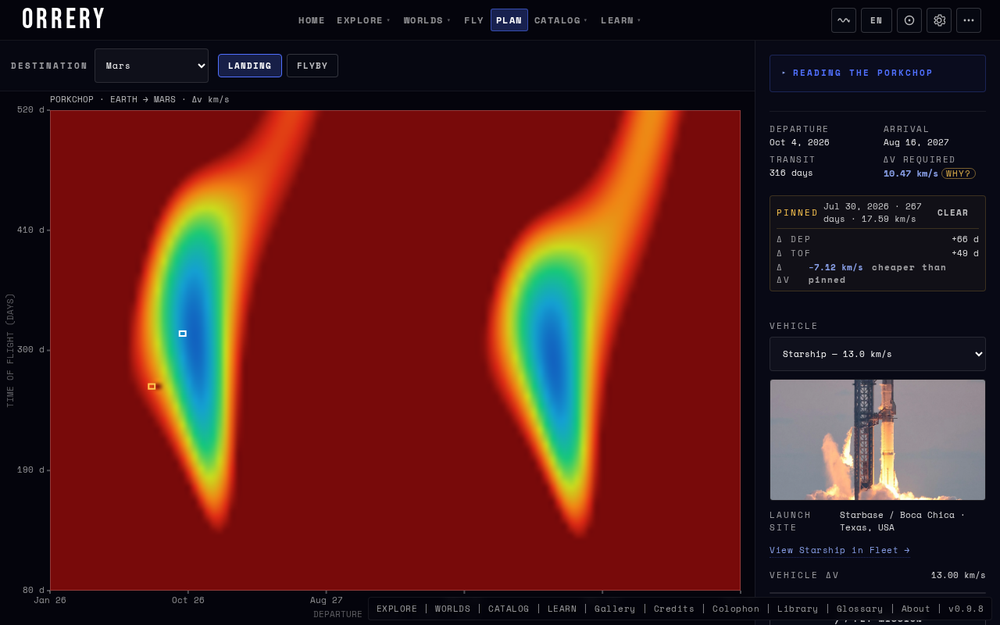](screenshots/13-mission-sandbox.png)

---

## Mission Arc · `/fly`

The mission visualisation. Earth, the destination, and the spacecraft animate live; the trajectory tube uses a true two-point Keplerian ellipse with Sun at focus, so both endpoints lock to live planet positions.

[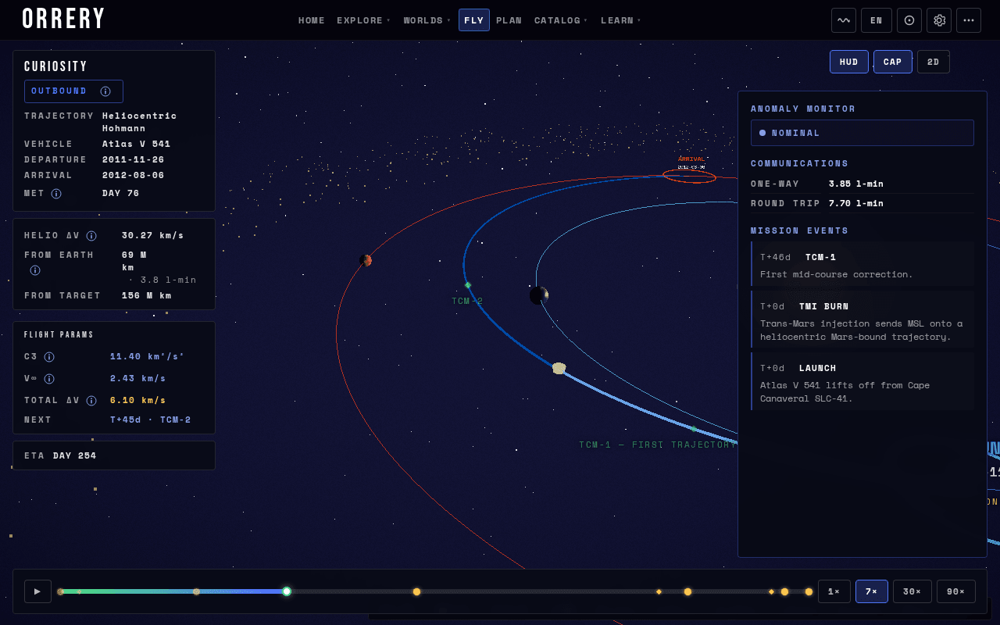](screenshots/03-fly-curiosity.png)

**What you can do**:

- **Scrub the timeline** — bottom bar — to fly the mission from launch to arrival.
- **▶ / ⏸ + speed pills** — autoplay at 1× / 7× / 30× / 90× (Mars-class missions) or 0.1× / 0.5× / 1× / 3× (lunar).
- **`2D` toggle** — switch between the 3D scene and a top-down 2D view.
- **CAPCOM panel** (right) — live mission events (TLI, TCM, EDL, etc.) tick by as you scrub.
- **Pre-built missions**: try `/fly?mission=<id>` for any of the 139 missions in the catalog.
- **The briefing card**: every flight opens on a card with the mission's photo, story, vehicle, payload, ∆v and transit, the fleet craft it flew, and three buttons — **START WITH LAUNCH** (the ascent from the pad), **SKIP TO LANDING** (the descent, where the mission has one) and **PROCEED TO SIMULATION** (the cruise).
- **Play bar and markers**: one marker row carries the whole journey — ascent beats (liftoff, MAX-Q, stage separation, fairing, SECO, parking orbit, injection burn), cruise milestones (gold dots), Flight Director stages (gold diamonds) and descent beats where a profile exists. Click a marker to seek there.
- **Phase markers** appear on every mission with timeline events — click any marker dot to jump the sim to that event's MET (LOI, TCM, descent, arrival, EDL). Each marker carries a science-chip linking to the matching `/science` encyclopedia section. Keyboard-focusable + screen-reader-readable. Reduced-motion: snap, no animation.
- **Lunar missions** (Apollo, Artemis II, Blue Moon, Chang'e, Chandrayaan, Luna, SLIM) auto-open in a dedicated **cislunar view** (ADR-058) anchored at Earth, rendering each mission's actual flight architecture — Apollo free-return figure-8 with parking orbit + lunar orbit + descent, Artemis II hybrid free-return at 9 200 km periselene, Chandrayaan-3 multi-burn Earth spiral + lunar spiral + descent, Chang'e 5 lunar-orbit-rendezvous sample-return, etc. The camera zooms in as the spacecraft approaches the Moon and pulls back as it leaves.
- **Mars + outer-system missions** render the heliocentric transfer arc (Earth → target body) via `flight.interplanetary_profile` waypoints (ADR-058 third amendment), with the same phase-marker overlay + science chips as Moon missions. Mariner 4 (1964) through Hope Probe (2020), Voyager 2's Grand Tour flybys, New Horizons' Jupiter assist + Pluto + Arrokoth, Dawn's Vesta-then-Ceres.

[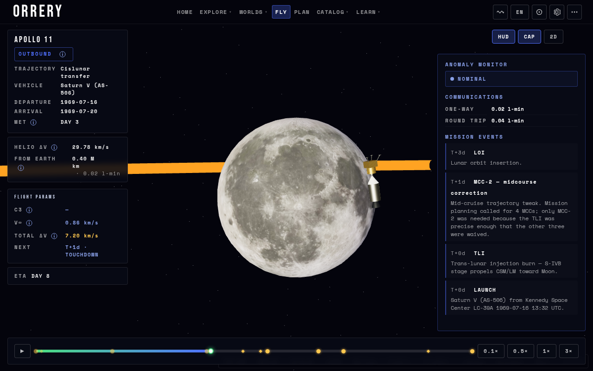](screenshots/03-fly-apollo11.png)

**The launch.** START WITH LAUNCH plays the ascent under a **seeded camera director**: the same launch always replays the same shots, and different launches differ (the seed is the vehicle and the mission). The first seconds are a vertical rise; the scene draws the **real pad** of the launch site and year — the Apollo launch umbilical tower, the Shuttle service structures, the Soviet R-7 and Proton pads, the Falcon transporter-erector, the SLS mobile launcher — built to scale against the vehicle, with moving parts (swing arms, support arms, the strongback) tied to the mission clock, so scrubbing never jumps. The light follows the **real launch time** at the pad when the data has one (night, dusk, golden hour or midday, with cloud and pad smoke); a flight without a recorded time is seeded. Append `?cam=classic` for the old fixed camera. With reduced motion on, the director uses hard cuts.

[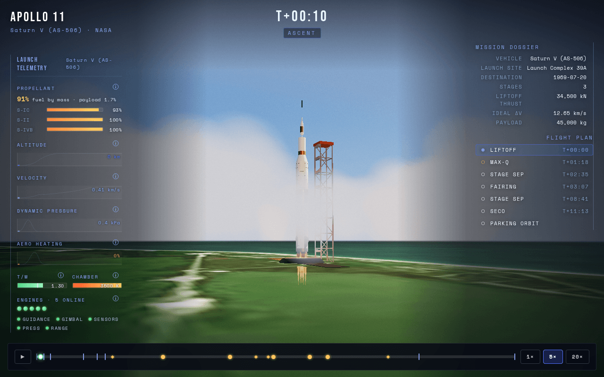](screenshots/19-fly-launch-director.png)

**The 2D view** fits the flight: it draws only the destination (and, for a planetary moon, its host), keeps one scale for the whole flight and shows a 1 AU bar.

**Turn on the Science Lens** for the **Flight Director banner** — a 5-phase narration that flips through the mission as you scrub:

[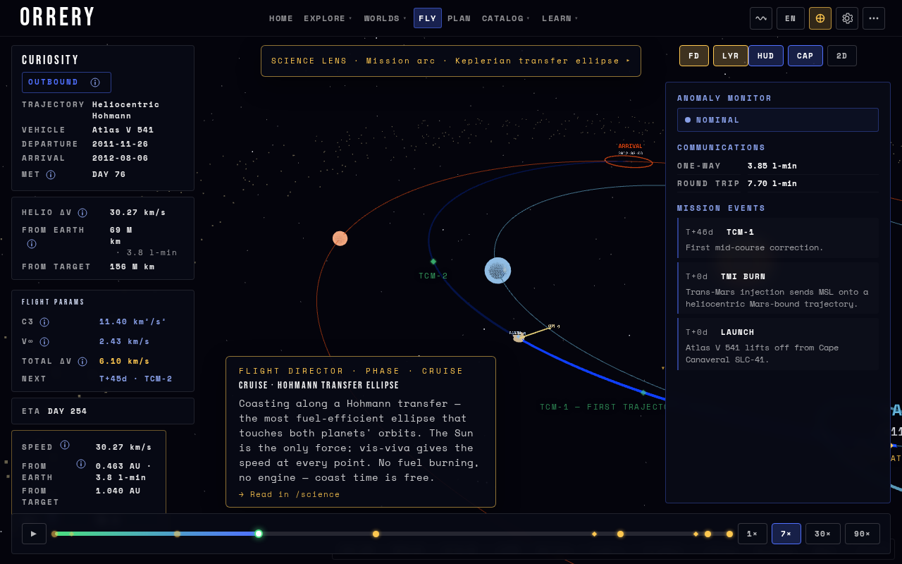](screenshots/12-flight-director.png)

| Phase | What it explains |
|---|---|
| **DEPARTURE** | C3 launch energy, leaving Earth's gravity well |
| **TRANS-X INJECTION** | The biggest single ∆v of the trip — TLI for Moon, TMI for Mars |
| **CRUISE** | The Hohmann transfer ellipse, vis-viva at every point |
| **APPROACH** | V∞ excess speed, minimum braking ∆v before insertion |
| **ARRIVAL** | Hyperbolic capture into a closed orbit |

Each phase title is a deep link into the matching `/science` chapter. The lens also unlocks a **Conic-section side panel** in the bottom-right that classifies the current arc shape (circle / ellipse / parabola / hyperbola) live from specific orbital energy.

---

## Mission Catalog · `/missions`

All 139 missions in the dataset, 1957 to 2031: Earth orbit (45), Moon (37), Mars (23), Venus (6), Jupiter (5), Saturn (4), Mercury (3), the Sun (3), and comets, asteroids, Neptune and Pluto, from Sputnik 1 to Starship Mars Crew (concept). The page was previously called "Mission Library"; it was renamed to **Mission Catalog** under [ADR-051](../adr/ADR-051.md) to free the word _Library_ for the outbound-link inventory at `/library`.

[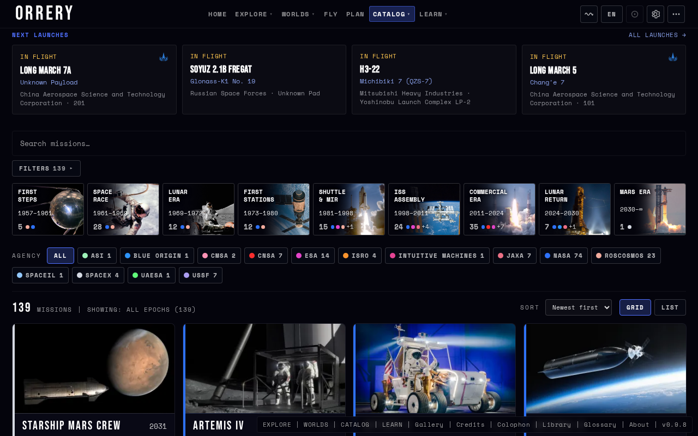](screenshots/04-missions.png)

### The catalogue pattern

`/missions`, `/fleet`, `/programs` and `/missions/launches` share one page pattern, so what you learn on one works on the others:

- **Search** box at the top, then the **`FILTERS` chip** with the total.
- **Era strip** — nine tiles, First Steps (1957–1961) · Space Race · Lunar Era · First Stations · Shuttle & Mir · ISS Assembly · Commercial Era · Lunar Return · Mars Era (2030+). Each tile carries a flagship photo, its count and the agency dots of what is in it; click one to show that era only (the line under the filters reads `Showing: <era> (n)`); arrow keys move between tiles. An era with nothing in it is dimmed and cannot be selected. Programs are placed by start year, launches by launch year.
- **Agency chips** — one colour per agency (dot, name, count), the same colour as the dot on the era tile and the bar on each card. "Show all N" opens the rest.
- **Toolbar** — the count and what is showing, **SORT**, and **GRID / LIST**.
- **Cards** — a photo, the name and year, one line per agency (a bar in its colour, then the name), a status pill and a one-line story.

**What you can do on `/missions`**:

- **Next launches** — the strip at the top shows the next launches from the launch calendar; **ALL LAUNCHES** opens `/missions/launches`.
- **`FILTERS` chip** — expands the destination, status and crew pills (collapsed by default for a clean grid; the era strip and agency chips are always visible). When you land via a deep link with filter params (`?dest=MARS`, `?from=1969`, etc.) the strip auto-expands so you can see what's active.
- **Filter** by destination / agency / status.
- **Click any card** — opens a detail panel with OVERVIEW · FLIGHT · GALLERY · SCIENCE tabs.
- **▶ FLY THIS MISSION** from any panel — jumps to `/fly?mission=<id>`.
- **FLIGHT tab** carries per-mission ∆v ledgers, with caveat banners (RECONSTRUCTED / SPARSE / UNKNOWN) when the public data is incomplete.

[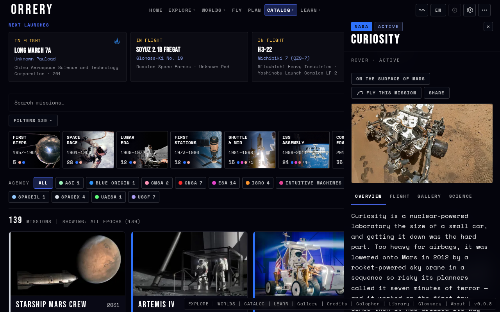](screenshots/mission-panel.png)

**Launches** (`/missions/launches`) opens as a **month-grouped list** (soonest first; GRID is the other view) of the upcoming-launch calendar from Launch Library 2 and the historic launches from GCAT, with a **VIA LL2** provenance chip on every row. The era strip counts launches by launch year; the chips are launch providers.

[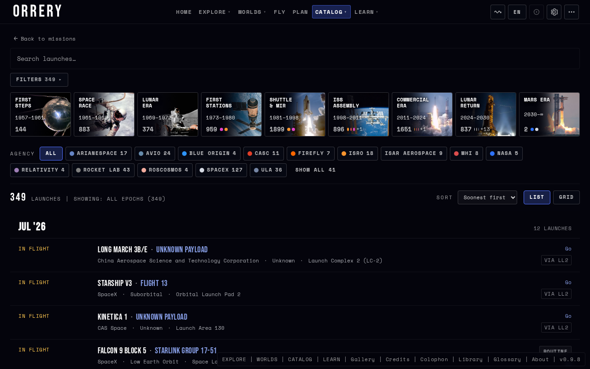](screenshots/18-launches-catalogue.png)

### Programs · `/programs`

42 programs — Apollo, Artemis, Ariane, Buran, Cassini, Chandrayaan, the commercial stations, Project Kuiper and more. The head of the page is a row of mission patches; the rest is the catalogue pattern above. A program page lists its missions, hardware and milestones.

[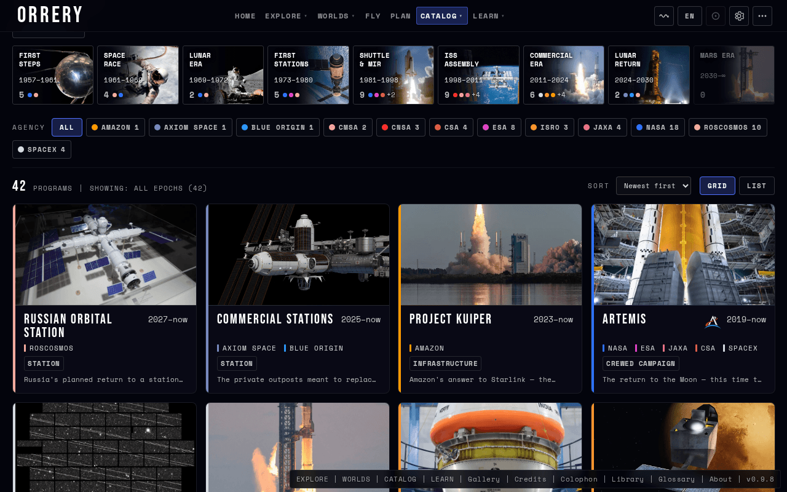](screenshots/17-programs-catalogue.png)

### Spaceflight Fleet · `/fleet`

299 entries in 12 categories — crewed spacecraft, cargo spacecraft, launchers, engines, landers, orbiters, rovers, observatories, stations, space suits, constellations, launch sites — each cross-linked to the missions and sites that used it.

[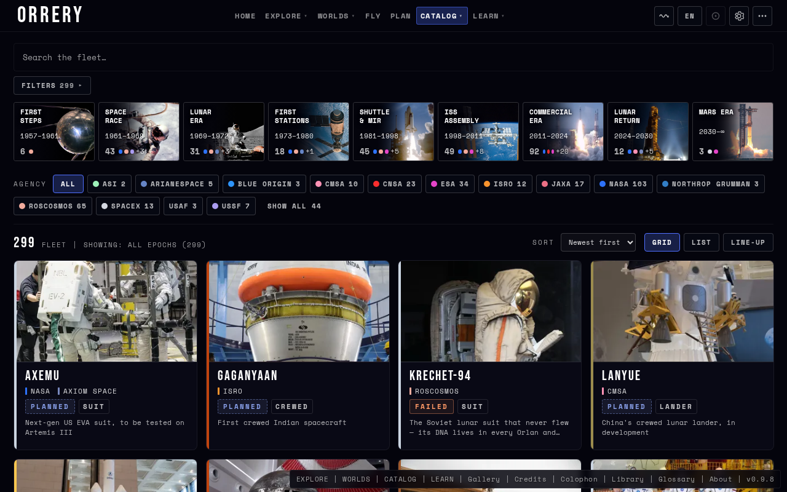](screenshots/16-fleet-catalogue.png)

- **GRID / LIST / LINE-UP** — LINE-UP compares the launchers, or the capsules and spacecraft, at scale (`?view=lineup&kind=launchers|spacecraft`); while it is on, the FILTERS chip is disabled.
- **Click any card** for the detail panel: GALLERY, **ANATOMY** (198 hand-generated cutaways: 158 spacecraft and 40 launcher sketches), TECHNICAL, LEARN, and one **MISSIONS** tab that lists every mission the craft flew, oldest first. `/fleet/<id>` shows the same list.

---

## Earth Orbit · `/earth`

Logarithmic radial scale showing the infrastructure that surrounds Earth: ISS, Tiangong, Hubble, JWST, Gaia, Chandra, XMM-Newton, LRO + the four GNSS constellations (GPS, Galileo, GLONASS, BeiDou) + GEO ring.

[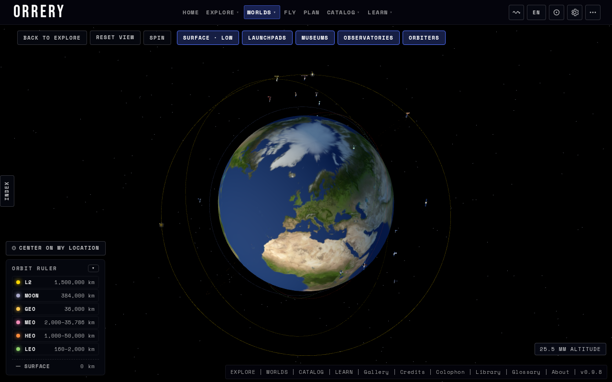](screenshots/05-earth.png)

**What you can do**:

- **Drag** to orbit Earth, **scroll** to zoom in toward the surface (the altitude readout at the bottom right follows); objects sit at their real inclinations. **SPIN** and **RESET VIEW** are in the top row.
- **Click any object** — detail panel with launch / period / inclination / crew / capability fields, plus GALLERY · LEARN · SCIENCE tabs.
- **Layer chips** (top row) toggle SURFACE · LOW (the surface detail level), LAUNCHPADS, MUSEUMS, OBSERVATORIES and ORBITERS.
- **INDEX** (left edge) lists every object; **CENTER ON MY LOCATION** turns the globe to where you are.
- **ORBIT RULER** (bottom left) lists the regimes from LEO to L2; each row draws its own band.

**Lens layers**: an **atmosphere shell** at the Kármán line (100 km) and **ozone-hole indicators** over both poles (Antarctic + Arctic depletion zones) appear when the Science Lens is on.

---

## Moon Map · `/moon`

21 surface sites across 7 nations (USA, USSR / Russia, Europe, China, India, Japan, Israel) plus 9 orbiters, plotted by latitude / longitude on a 3D Moon globe and a 2D equirectangular projection.

[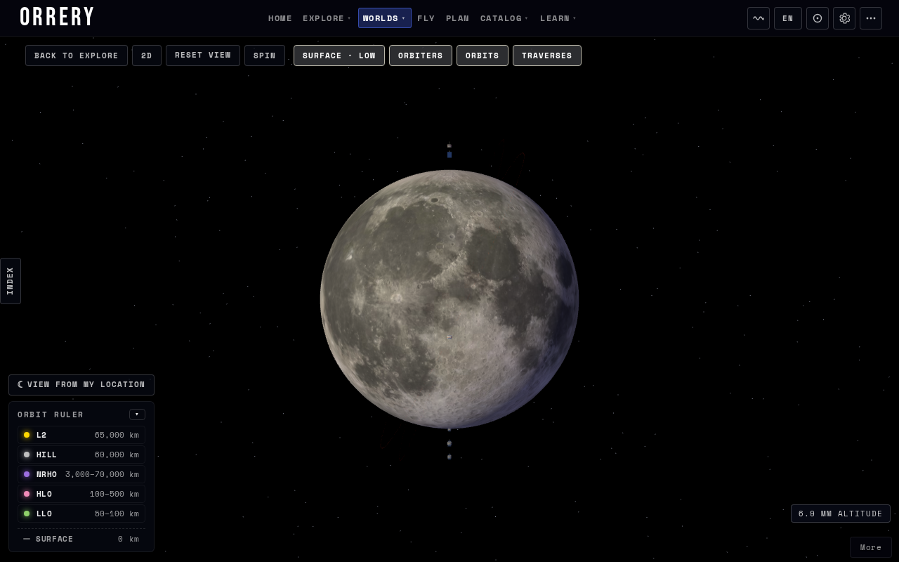](screenshots/06-moon.png)

**What you can do**:

- **3D Moon** — drag to rotate, scroll to zoom, click any marker for site detail.
- **2D map** — equirectangular projection; click any marker for the same panel.
- **Chips** (top row) — SURFACE · LOW, ORBITERS, ORBITS and TRAVERSES.
- **Site panel** — OVERVIEW · GALLERY · STORY · LEARN, plus mission-specific fields (crew, surface time, samples returned, capability unlocked) and the actions STAND HERE (a panorama from the site), VIEW ROUTE, ZOOM IN and SHARE.
- **Traverses** — eight rover and astronaut routes (Apollo 15, 16 and 17, Lunokhod 1 and 2, Chang'e 3 and 4, Chandrayaan-3) are drawn in the same style as the Mars rover routes: a colour ramp by distance driven from the lander, kilometre milestones, a ring at the landing site and a hover card ("N km from landing"). Six are real mapped tracks; the two nine-point outlines (Chang'e 3, Chandrayaan-3) are labelled "Approximate route".

[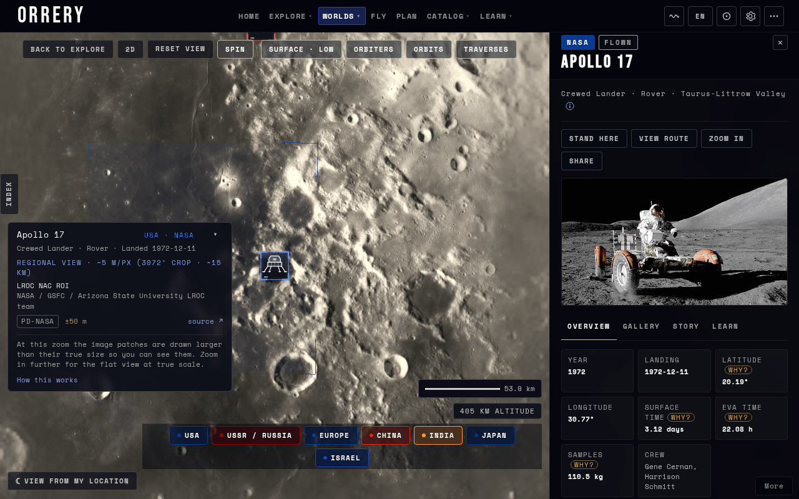](screenshots/22-moon-traverse.png)

**Lens layer**: **tidal-lock indicator** marks the Moon's near-side hemisphere (always Earth-facing — the result of synchronous rotation) when the Science Lens is on.

---

## Mars Surface Map · `/mars`

Equirectangular 2D map + 3D globe with surface-feature panels for landing sites, orbital probes, and major regions.

[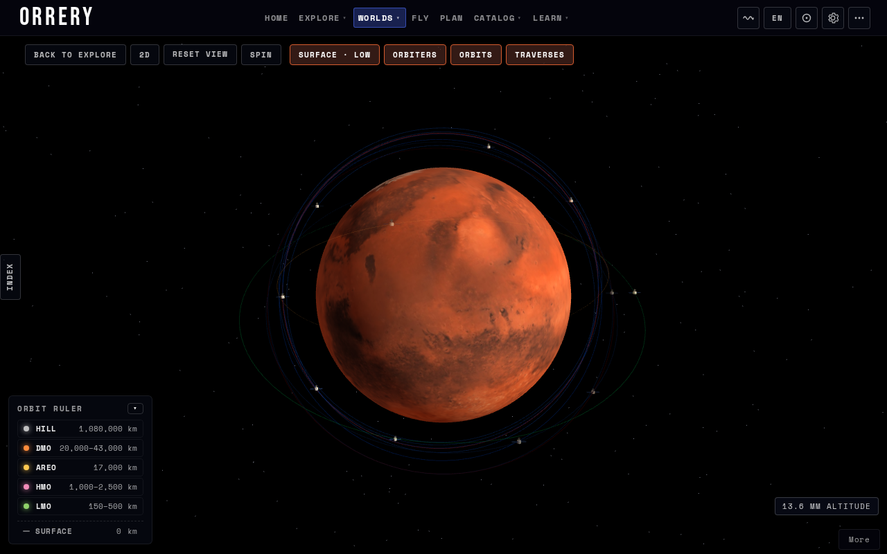](screenshots/07-mars.png)

**What you can do**:

- **3D / 2D toggle** — drag the globe in 3D or scrub a flat equirectangular projection.
- **16 surface sites** (rovers, landers, sample-return) + **11 orbital probes**, each clickable for a detail panel.
- **Rover traverse paths** overlaid as cross-linked routes on Curiosity, Perseverance, Opportunity, Spirit and Zhurong (toggle them with the **TRAVERSES** chip).
- **Layer chips** (top row) — SURFACE · LOW, ORBITERS, ORBITS and TRAVERSES.
- **Lens layer**: an **atmosphere shell** at ~120 km marks Mars's effective atmospheric edge.
- **Cross-links**: Curiosity / Perseverance panels deep-link to `/missions/<id>` for the full mission record.

---

## ISS Explorer · `/iss`

A full station-explorer route with raycast-pickable modules. 18 modules from every USOS + ROS module to visiting craft (Crew Dragon, Cargo Dragon, Soyuz MS, Cygnus, Progress MS, HTV-X, Starliner, Shenzhou, Tianzhou).

[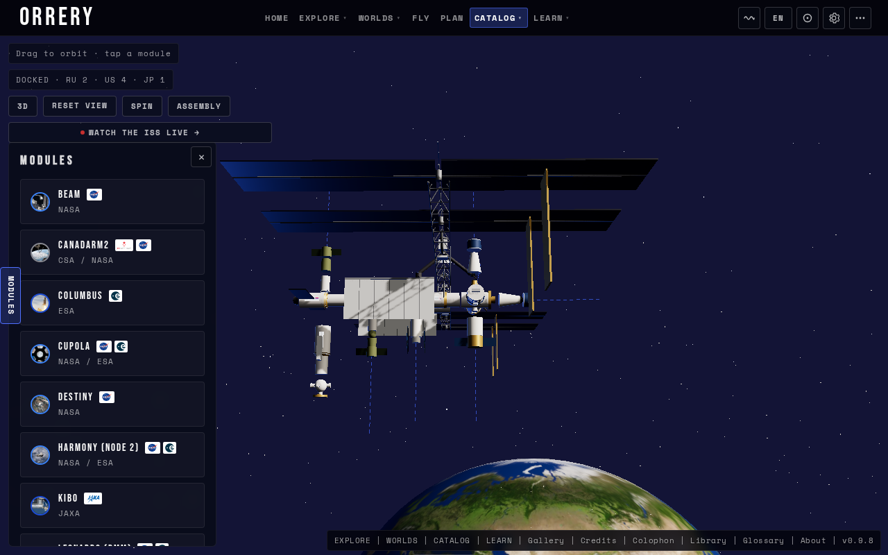](screenshots/08-iss.png)

**What you can do**:

- **Drag** to orbit the station; **scroll** to zoom; **right-drag** (or two-finger drag on touch) to pan.
- **Click any module** — opens a detail panel with **OVERVIEW · GALLERY · TECHNICAL · ANATOMY · SCIENCE · LEARN** tabs.
- **`MODULES` button** — opens a drawer listing every module with its agency badge; click any entry to fly the camera to it.
- **`PAUSE SPIN` / `RESUME SPIN`** — freeze the station's rotation for clear screenshots.
- **`RESET`** — return to the default camera position.
- **Solar arrays auto-track the Sun** with a slow continuous rotation.
- **Hover any module** to see its name in a label sprite that tracks the module's projected screen position.

**ANATOMY tab**: hand-drawn schematics for 9 visiting spacecraft (Crew Dragon, Cargo Dragon, Cygnus, Soyuz MS, Progress MS, HTV-X, Starliner, Shenzhou, Tianzhou) — each shows hatch/docking, propulsion, life-support, and trunk layouts with named callouts.

**Orbit-regime banner** at the top reads ALT · INCL · PERIOD with **Why?** popovers on each value (why ~400 km, why 51.6°, why ~92 min, why 16 sunrises a day).

**Lens layer**: turn on the Science Lens for a **microgravity axes overlay** — three colour-keyed body axes (zenith/nadir, prograde/retrograde, port/starboard) drawn at the station centre with value labels at each arrow tip. The lens also opens an **Orbital regime** card (altitude, inclination, period, each with a Why? popover) and a **Microgravity frame** card that explains the three axes.

[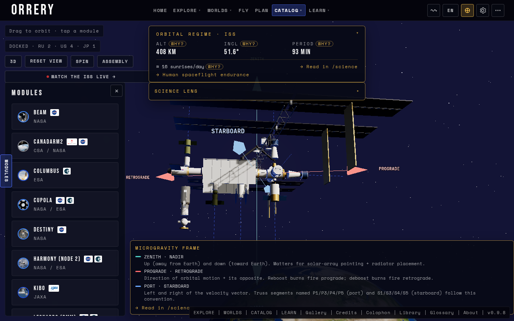](screenshots/11-science-lens-iss.png)

---

## Tiangong Explorer · `/tiangong`

China's space station. Tianhe core + Wentian + Mengtian lab modules with sun-tracking gallium-arsenide arrays. Mirrors the `/iss` UX on the same shared `station-geometry` library.

[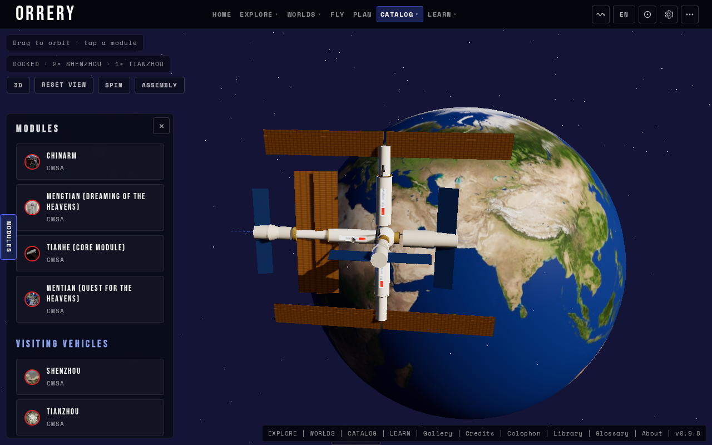](screenshots/09-tiangong.png)

**What you can do** (matches `/iss` interactions):

- **Click any module** — detail panel with same tab set as `/iss`.
- **`MODULES` drawer** with agency badges (CMSA · CASC).
- **2D blueprint views** — `2D ▾` switches between top, side, and front orthographic projections.
- **Per-module hover labels** + selected-module emissive pulse.
- **Microgravity axes overlay** lens-gated, same as `/iss`.

**Visiting craft** (Shenzhou crewed + Tianzhou cargo) render in their docked positions.

---

## Science Encyclopedia · `/science`

The in-app explainer for every concept the simulator visualises. **175 sections across 13 tabs**, plus a Glossary and an editorial Space-101 narrative on the landing page.

[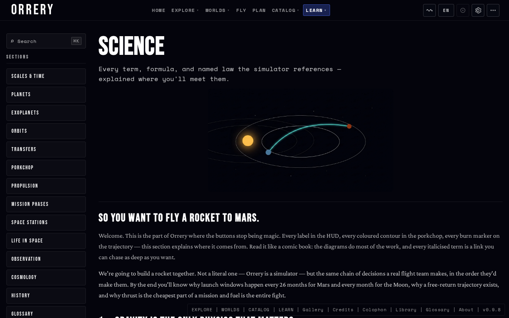](screenshots/10-science-landing.png)

**Tabs**:

| Tab | What's in it | Sections |
|---|---|---|
| **Scales & Time** | AU, light-minute, ecliptic plane, J2000, sidereal vs synodic, reference frames, long-duration | 7 |
| **Planets** | The asteroid belt, the Kuiper belt, axial tilt and seasons, magnetic fields, lunar ice, how the Earth and Mars surface imagery layers work | 14 |
| **Exoplanets** | Detection methods (astrometry, direct imaging), atmospheres, the habitable zone, biosignatures, 51 Pegasi b | 19 |
| **Orbits** | Kepler's laws, vis-viva, semi-major axis, eccentricity, inclination, true anomaly, apsides, orbit regimes, Keplerian orbit, Lagrange points, Hill sphere | 18 |
| **Transfers** | Hohmann, Lambert problem, transfer ellipse, free return, gravity assist, conic sections, patched conics | 8 |
| **Porkchop** | What is a porkchop, departure axis, time-of-flight axis, ∆v heatmap, contour reading, viability | 6 |
| **Propulsion** | Tsiolkovsky equation, specific impulse, ∆v budget, C3 launch energy, V∞, Oberth effect | 21 |
| **Mission Phases** | Launch, trans-X injection, TCM, orbit insertion, EDL, EVA, MET, NRHO, mission types | 29 |
| **Space Stations** | Pressurised volume, node-module structure, solar-power budget, expedition cadence | 4 |
| **Life in Space** | Microgravity, radiation, IVA / EVA / lunar suits, long-duration life support, crew-health topics | 26 |
| **Observation** | Adaptive optics, black holes, coronagraphs, interferometry, space photography, spectroscopy, wormholes | 14 |
| **Cosmology** | The cosmic distance ladder, Laniakea and the Great Attractor, large-scale structure (the cosmic web) | 3 |
| **History** | Kepler 1609 · Newton 1687 · Tsiolkovsky 1903 · Goddard 1926 · Sputnik 1957 · Apollo 11 1969 | 6 |

[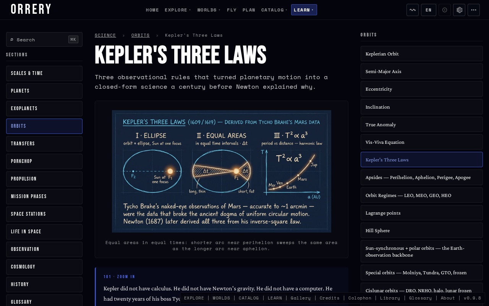](screenshots/10-science-section.png)

**What you can do**:

- **Click any tab** in the left rail (sticky on desktop; folds to a single column on mobile).
- **Right rail** lists every section in the active tab; click to navigate, current section is highlighted.
- **Cmd-K / Ctrl-K** opens a search overlay across the entire encyclopedia — type a few letters of any concept (vis-viva, Hohmann, Kármán, etc.) and Enter navigates straight to the section.
- **Cross-screen `?` chips** — every numeric label across `/missions`, `/fly`, `/explore`, `/plan`, `/earth`, `/moon`, `/mars`, `/iss`, `/tiangong` carries a `?` chip that deep-links to the matching encyclopedia section.
- **Why? popovers** on individual values inline-explain the meaning without a route change.

**Math**: KaTeX server-rendered at build time per [ADR-034](../adr/ADR-034.md) — the client receives static HTML, no JavaScript math library is shipped. **Diagrams**: hand-coded SVGs in an engineering-blueprint style, with a fail-closed integrity gate on every build, per [ADR-035](../adr/ADR-035.md).

---

## Essays · `/essays`

*The Long View* — 13 essays in one story told in a spiral, grouped into themes such as "Into the dark" (how we find our way, move, and stay in touch where there are no roads). Each essay is a card with a diagram or picture; the essays' outbound sources are in the [`/library`](#library-every-outbound-learn-link).

## Physics Lab · `/lab`

First-principles physics, one goal at a time. Pick a **goal** ("Launch a rocket" is the first) and the lab opens a **Notebook** of calculator cards: each card is a formula with its inputs, a live figure on the blueprint grid, and the derivation in `/science`. **Canvas** is the other workspace: drag cards, wire one card's output to another's input, and promote a subgraph to a notebook. **SHARE** copies a link to the notebook; **LAB REPORT** and **SHARE CARD** export it; **SAVE** / **LOAD** keep a notebook as a `.orrlab` file. Every calculator also has its own page (`/lab/tsiolkovsky`).

## Worlds, Live and the hubs

`/worlds` is the hub for the four worlds you can stand on (Earth, Moon, Mars and Venus; Venus is a globe with orbiters). `/live` shows the permanent ISS stream and launches happening now or soon, in-app, credited to the official channels. `/catalog` and `/learn` are the hubs of the CATALOG and LEARN menus.

---

## Gallery · `/gallery`

Orrery's visual collections — things to look at, download, and keep, free to use and credited in full. The hub has one strip per collection:

[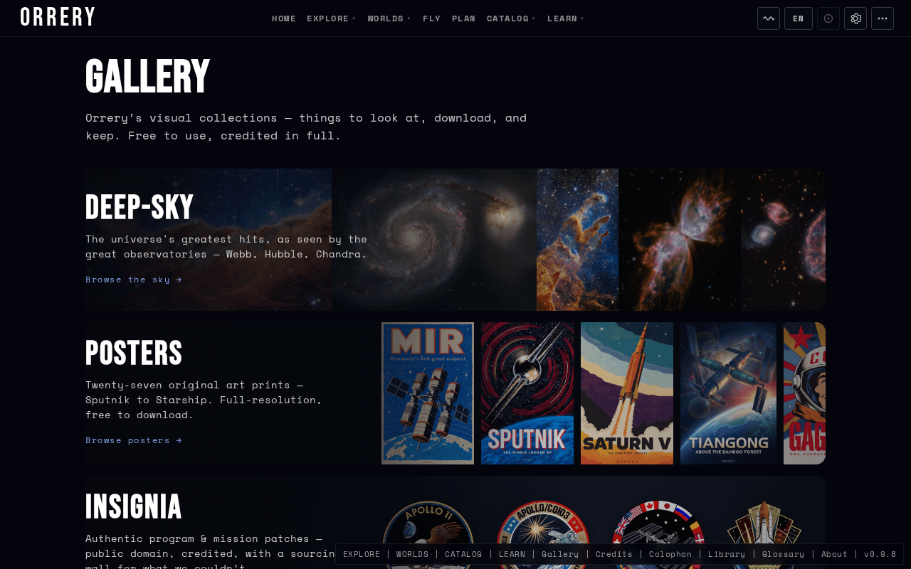](screenshots/21-gallery.png)

- **Deep-sky** (`/gallery/deep-sky`) — the universe's greatest hits as seen by Webb, Hubble and Chandra, with filter pills; each image opens in a viewer that fits one screen, with its facts, credit line and button always inside the window.
- **Posters** (`/posters`) — 27 original space posters, every era and agency from Sputnik to Starship; click any poster for the full-resolution file, ORRERY wordmark on every piece.
- **Insignia** (`/patches`) — the patches crews wore and programs flew; every one is an authentic public-domain NASA design, credited in full. Where a program never had a patch, or none exists under a free licence, the sourcing wall says so.

---

## Provenance pages

Long lists on these pages follow one rule: a list shows its **first 10 rows** and a **Show all N** chip; source headers stay open, so a `#src-<id>` link lands on the header with its first rows below it.

### `/credits` — every image, text source, and logo

Public attribution page generated from `static/data/image-provenance.json` (auto-built by `scripts/build-image-provenance.ts`), `static/data/text-sources.json`, and `static/data/source-logos.json`. Every image in the app appears here with its license, source, and the original URL.

[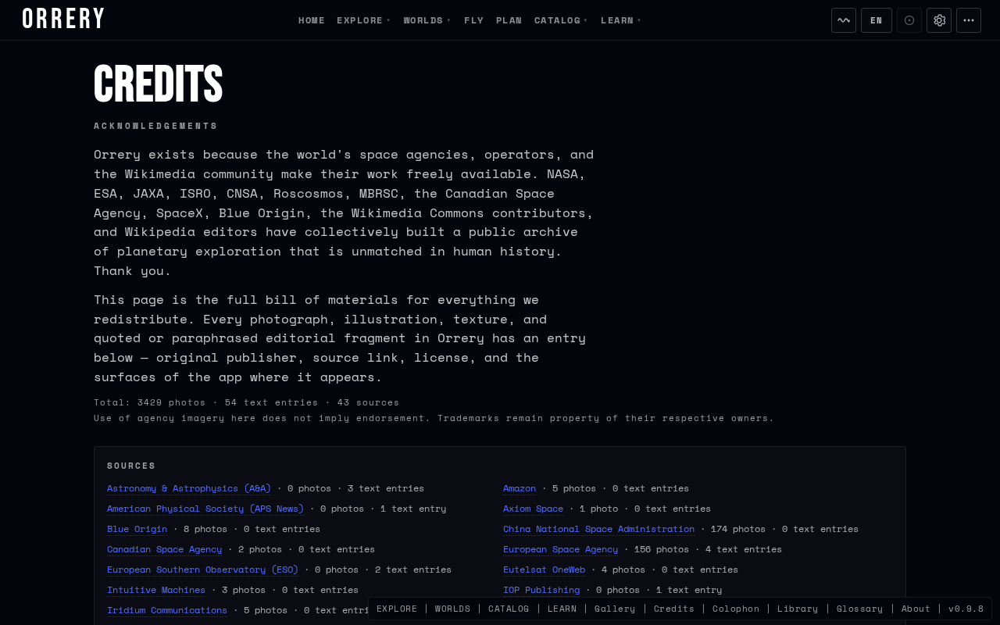](screenshots/14-credits.png)

Image sourcing is **agency-first** per [ADR-046](../adr/ADR-046.md): NASA / ESA / ISRO / CNSA / JAXA / KARI / Roscosmos before Wikimedia Commons fallback. Per-image provenance is AJV-validated and **fail-closed** in `validate-data` (per [ADR-047](../adr/ADR-047.md)) — adding an image without a provenance row breaks CI.

### `/library` — every outbound LEARN link

Bill-of-links across the entire app. Each external link the app exposes (in panel LEARN tabs, `/science` sections, the essays' sources, `/credits` source URLs) appears here with its provenance row: source agency, language, freshness check date, status. Five blocks at the head name the data sources behind the app — Audio episodes, Launches data, Astrophysics data, Planetary models (NASA JPL) and Moon and Mars surface data — before the per-source tables.

[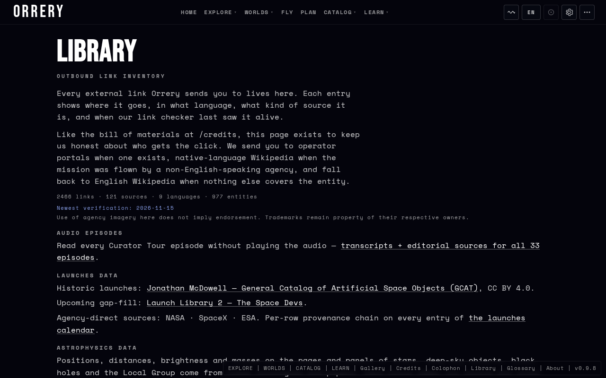](screenshots/15-library.png)

Link policy is **agency-first, native-language priority** per [ADR-051](../adr/ADR-051.md): for non-US entities, the operator's own page (in their own language) wins over the NASA mirror. Roscosmos before Wikipedia. ISRO before press releases. The link-checker (`scripts/check-learn-links.ts`) is chained into `npm run fetch` so dead links are flagged before they ship.

---

## Mobile

Every screen works at 375 px width. Touch targets are 44×44 px minimum. Bottom-sheet panels swipe down to dismiss. The porkchop magnifier loupe is mobile-only (long-press on the plot).

The PWA manifest is shipped — install Orrery as a standalone app via the browser menu (Chrome / Safari / Firefox all support this; the in-app install nag is intentionally suppressed per [ADR-029](../adr/ADR-029.md)).

---

## Privacy

- **Analytics**: aggregate only, self-hosted ([Umami](https://umami.is/)) — page-view counts per route and a few structured events, never anything that identifies you. You can switch it off on [`/privacy`](https://www.orrerylearn.com/privacy).
- **Error tracking**: unhandled JavaScript errors only, to a self-hosted GlitchTip; no PII, no session replay.
- **Cookies**: three functional cookies, each written only on a deliberate action — `orrery_locale` (when you click a locale chip), `orrery_tour` (Curator Tour resume position) and `orrery_analytics_optout` (when you opt out).
- A few device-local `localStorage` keys hold rendering preferences (quality tier, debug mode, offline downloads); settings, no PII.
- No third-party fonts, images, or scripts loaded at runtime — every asset is bundled at build time per [ADR-016](../adr/ADR-016.md).

The state that persists across sessions is what's in the URL (`?lang=`, `?mission=`, `?dest=`, etc.), the cookies and keys above, and the service-worker cache (so the app works offline after the first load). The full list, with the ADR behind each item, is in the README's [Privacy](https://github.com/chipi/orrery#privacy) section.

---

## Troubleshooting

**The 3D scene is empty.** Most likely WebGL is disabled in your browser. Try a different browser or enable WebGL.

**The 3D scene drops to a list view.** `/iss` and `/tiangong` auto-fall back to a module list when measured FPS drops below 20 (typically on integrated GPUs running with software rasterisation). Reload — sometimes the first paint is slower than later runs.

**Images don't load.** Either you're offline before the service worker has cached them, or the agency image API is rate-limiting. Reload after a minute; cached images persist.

**A translation looks weird.** All 14 locales now ship at 100% UI parity AND full editorial overlay coverage as of v0.6.x. If a string reads off, file an issue; the [i18n style guide](i18n-style-guide.md) is the binding source of truth per [ADR-033](../adr/ADR-033.md).

**Missions render outside the camera.** Moon missions render in a dedicated cislunar view at true Earth-Moon scale (ADR-058); interplanetary missions render heliocentrically with an auto-zoom that pulls in at departure and arrival. Drag to pan; scroll to zoom — manual zoom wins over auto-zoom until the next phase transition.

**A linked external page is dead.** File an issue or PR — the provenance manifest at `static/data/link-provenance.json` is the source of truth and welcomes corrections. Run `npm run check-learn-links -- --update` to regenerate the freshness gates.

---

## Where to next

- **[02 Project Concept](../concept/02_Project_Concept.md)** — the complete synthesis of what Orrery is.
- **[03 Data Catalog](../concept/03_Data_Catalog.md)** — every constant, every source, mission schema, credit format.
- **[i18n style guide](i18n-style-guide.md)** — the binding glossary for translators.
- **`AGENTS.md`** in the repo root — engineering constraints if you're contributing code (visible on GitHub: <https://github.com/chipi/orrery/blob/main/AGENTS.md>). Tool-specific overlays for Claude Code and Cursor live in `CLAUDE.md` and `.cursor/rules/orrery.mdc` respectively, both of which point back at this file.
- **In-app**: open the `/science` encyclopedia and read the **Space-101** narrative on the landing page — an 8-chapter primer that takes you from "what is an orbit" to "how a Hohmann transfer works" with no jargon.
